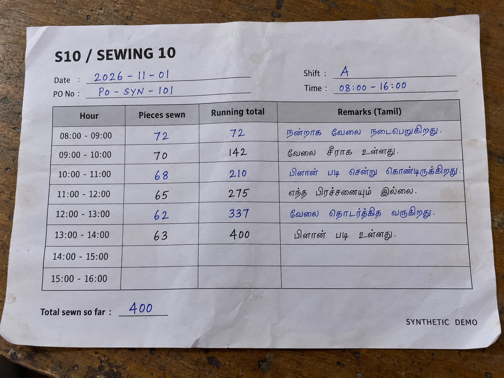

# Factory OS · local AI production-status prototype

A local AI prototype for turning messy factory updates into a short, source-linked production outlook. All supplied factory records and photographs are synthetic.

**Built deliberately with LangGraph and Langfuse.** LangGraph defines the steps from OCR and source loading to pace calculation, Qwen reasoning, source checks, and clear/unclear routing. Langfuse provides optional tracing of the run and model calls, so prompts, responses, latency and available token usage can be inspected. Local stage traces remain available without cloud tracing.

**The question:** Given six hours of output, a PO due date, the remaining work plan, and floor updates, can sewing finish on time? What needs attention?

The app accepts a photographed sheet or pasted WhatsApp message. It reads the input with local models, calculates pace scenarios in Python, and returns one short report. All supplied factory records and photographs are synthetic.

[Run locally](docs/RUNBOOK.md) · [Architecture](docs/ARCHITECTURE.md) · [Evaluation rubric](docs/EVALUATION.md) · [Evidence and limits](docs/RELIABILITY.md) · [AI tools and decisions](docs/AI-TOOLS.md)



## Review the demo in five minutes

1. Read the architecture and the four scenarios below.
2. Run the app locally with Python 3.11+ and Ollama.
3. In **Input**, select a sample, upload a photo, or paste a factory message. Inspect or edit its PO/plan/handoff context.
4. Click **Run input → view output**. The app opens Output with an elapsed-time spinner, then shows the trace and one report.
5. Open **Eval criteria** to see the weighted rubric and release gates.

GitHub hosts the code and documentation. It does not host the running Streamlit app or the local models.

## What is implemented

| Part | Behavior |
|---|---|
| Input | Four S10 sheet examples, custom photo upload, and pasted production text |
| OCR | Actual local `gemma3:4b` image transcription through Ollama |
| Reasoning | Actual local `qwen2.5:7b` call using the message, PO, plan, handoffs and prior notes |
| LangGraph | An explicit state workflow separates model calls from calculation and source checks, then routes to a clear result or supervisor hold |
| Forecast | Python calculates slowest-recorded, average and fastest-recorded pace using explicit shift calendars |
| Report | One short conclusion, with date/count/source checks and details folded away |
| Langfuse | Optional root-run and model-generation traces for synthetic inputs, including prompts, responses and available usage; local JSON traces are always retained |
| Evaluation | A weighted 100-point rubric and 17 shared offline regression tests |

There are four navigation sections: **Workflow design**, **Input**, **Output + trace**, and **Eval criteria**. The navigation includes spacing below Streamlit's fixed header so its labels remain visible.

## Why LangGraph and Langfuse

- **LangGraph makes the decision path inspectable.** OCR, record loading, arithmetic, language interpretation and validation are separate nodes. Branches are explicit, and the app exposes the compiled graph and prompts for review. The forecast math stays in Python rather than depending on model arithmetic.
- **Langfuse makes model behavior inspectable.** Its run and generation observations connect a result to the prompt and local model call that produced it. This supports investigation of slow calls and unsupported answers, and comparison after prompt or model changes.

Langfuse export needs project credentials and explicit synthetic-data opt-in. Hosted receipt has not been independently verified in this release. Local inference has zero API charge; hardware cost is not measured. The evaluation rubric is documented, but automatic Langfuse evaluation scores and asynchronous sampling are not implemented.

## The four examples

Each example represents line **S10 / Sewing 10**, an eight-hour shift from 08:00 to 16:00. Six hourly entries are filled. The final two hours are blank. Blank future hours are not counted as zero output.

| Example | Six-hour output | Intended learning |
|---|---:|---|
| Steady work | 400 | Even the slowest observed pace can meet the sewing requirement under the supplied calendar |
| Machine stoppage | 188 | Average pace projects 752 pieces against 1,000 required; recovery is needed |
| Conflicting updates | 370 | A numeric projection can exist while source facts still need checking |
| Missing due date | 380 | Show shift progress, but do not invent a PO finish deadline |

These are scenarios, not prefilled model answers. The live path does not pass expected labels or fixture row text to image OCR. It reads the actual image. Figures depend on the transcription and supplied context.

## How the forecast works

For each observed hour, the program reads the **incremental pieces sewn** column. It excludes future hours and does not add running totals again. It then calculates:

```text
remaining pieces = PO requirement − reported sewing output
available hours = planned work hours between the as-of time and PO due time
projected capacity = current output + observed rate × available hours
```

The three scenarios use the lowest, mean, and highest observed hourly rates. Real zero-output hours are included. The lowest observed rate is not an absolute worst-case guarantee. The forecast assumes the supplied work calendar and continuation of the chosen pace. It concerns sewing completion, not confirmed QC clearance or shipment readiness.

## What was actually verified

- **17 shared regression tests pass**, covering source quotes, model failure handling, blank versus zero hours, calendar math, domain refusal, and the single-report date-conflict case. The full local workspace also passed 83 tests; historical source logs and their dependent tests are not included in this public copy.
- Real local OCR and Qwen calls completed on synthetic camera-style images. Counts were usable on tested sheets, but dates, Tamil text and blank cells were sometimes misread.
- Real local Qwen calls completed on custom text. Valid arithmetic can produce a scoped sewing-risk decision even when restart time remains unknown.
- Streamlit smoke checks exercised custom input, photo mode, automatic routing, the four-page navigation, and one consistent report. This is not a claim of complete browser or production testing.

[The reliability note](docs/RELIABILITY.md) summarizes observed results. Raw requests, recorded responses, source notes and private run history are not published. For example, OCR read a 2026 date as 2023. The report now says to check the date rather than showing both “on track” and “unclear” as competing conclusions. The original failure remains preserved locally; this public copy includes synthetic code regressions.

## Important limits

- No live WhatsApp connector, continuous ingestion service, voice demo, or factory PO/plan/handoff APIs are connected. The UI processes one event at a time with editable source context.
- No production system is changed. No operational outbox or human approval is created by the current web app. Unclear reports identify a supervisor follow-up but do not open a real task.
- Tamil handwriting and document-date accuracy are not validated. Some real OCR runs exceeded the 15-second target. There is no production accuracy or latency claim.
- The media golden set and asynchronous sampling job are planned, not implemented. Langfuse export is optional and receipt in a hosted project has not been independently verified here.
- The repository contains no credentials, private uploads, virtual environment, model weights or unrestricted run history. Model weights must be downloaded separately.

## Run

```bash
python3.11 -m venv .venv
source .venv/bin/activate
python -m pip install -r requirements-media.txt
# Start the Ollama desktop app or run `ollama serve` separately.
ollama pull gemma3:4b
ollama pull qwen2.5:7b
./run_media_demo.sh
```

Open `http://localhost:8501`. The models require several GB of disk and enough local memory. No paid inference API or API key is needed. See the [runbook](docs/RUNBOOK.md) for custom-input examples and optional tracing.

## Test

```bash
python -m unittest discover -s tests -v
```

The offline suite uses mocks and recorded synthetic failures. It does not download or run the models. GitHub Actions runs this same suite. An online model smoke run is a separate check.

## Code map

- [`app.py`](app.py): four-page Streamlit UI, custom input and report display.
- [`src/live_workflow.py`](src/live_workflow.py): compiled LangGraph, OCR/Qwen calls, source checks and saved outcomes.
- [`src/pace.py`](src/pace.py): date/identity checks and deterministic pace calculations.
- [`src/report.py`](src/report.py): one short, consistent report from the checked facts.
- [`src/llm.py`](src/llm.py): local Ollama clients and raw call logging.
- [`src/observability.py`](src/observability.py): optional Langfuse integration.
- [`data`](data): synthetic sheets, PO/plan records and regression fixtures.
- [`tests`](tests): offline regression coverage.

The current web application is the supported entry point. Some reusable source modules retain earlier prototype functions, but historical datasets and CLI records are not published.
