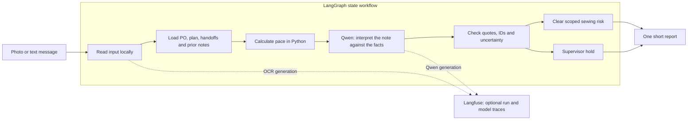

# Architecture and product choices

The design accepts a continuing stream of factory updates. The implemented demo runs one supplied photo or text event at a time. A live WhatsApp webhook and durable stream processor are not connected.

The actual compiled graph is built in `src/live_workflow.py`. The Workflow design page lets a reviewer inspect and download its Mermaid representation and view the exact prompts.

## Deliberate framework choices

**LangGraph** defines the state transitions and conditional clear/hold branches. Keeping record loading, arithmetic, model interpretation and validation in separate nodes makes the route understandable and testable. The graph runs in memory for each event; JSON outcomes are saved locally. This is not a claim of durable stream processing or restart-safe graph checkpoints.

**Langfuse** adds opt-in observability around the run and its local model generations. The integration records prompts, outputs, available token usage and timing metadata. Local per-node timings are saved independently of Langfuse. Cloud export requires configured project credentials and a synthetic-data opt-in. Hosted trace receipt and automatic evaluation scores are not verified or implemented, respectively.

## Model responsibilities

Gemma 3 4B transcribes the photo, including Tamil remarks. Text inputs preserve the original message. Qwen 2.5 7B receives that text and the supplied source records. Expected labels are excluded.

The model interprets language. It does not decide arithmetic truth. Python parses the incremental count column, checks row quotes, reconciles the total, and calculates rates within explicit working windows. PO and line must match the context. A forecast is scoped to reported sewing output; it does not create a confirmed handoff or shipment fact.

The report builder provides one user-facing verdict. A date conflict becomes “Check the date,” with a clearly stated pace estimate under the supplied date assumption. Detailed math and raw model responses stay available for inspection.

## Operational boundary

The application has no factory-write or send tool. A supervisor assignment is a suggested follow-up, not an integrated task. Historical CLI records are not included in this public copy. No web result is presented as human approval.

## Next steps

Connect authenticated message intake and real PO/plan/handoff APIs; version each source snapshot; replace OCR and prompts only after a reviewed media benchmark; add durable background jobs and real task creation; measure language accuracy and latency by input type. These are roadmap items, not shipped functionality.
